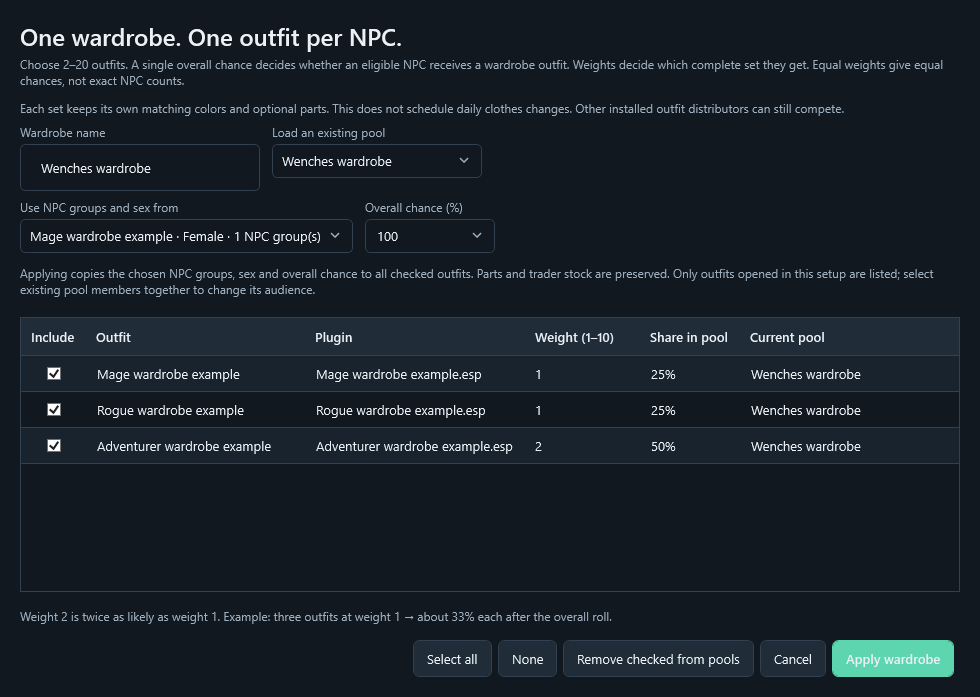

# Skyrim SPID Patch Generator — v0.4.11

## Download the Windows app

### [⬇ Download v0.4.11 for Windows — ZIP containing the EXE](https://github.com/waitWTF/Skyrim-SPID-Patch-generator/releases/download/v0.4.11-preview/Skyrim-SPID-Patch-Generator-v0.4.11-preview-Windows.zip)

Extract the **whole ZIP**, then run **SkyrimSPIDPatchGenerator.exe**. Keep **Runtime** and **Documentation** beside it. Requires **.NET 10 Desktop Runtime x64**. This is a development preview.

[Release details and all downloads](https://github.com/waitWTF/Skyrim-SPID-Patch-generator/releases/tag/v0.4.11-preview) · [All versions](https://github.com/waitWTF/Skyrim-SPID-Patch-generator/releases)

You do not need the right-hand sidebar or GitHub's **Code → Download ZIP** to get the working app. The direct link above downloads the Windows program; **Source.zip** is for contributors.

A Windows desktop tool for turning installed Skyrim SE/AE outfit mods into NPC outfits and/or trader merchandise, through a guided, scrollable setup.

**Community project, MIT licensed, developed with substantial AI assistance.** Contributions, fixes and forks are welcome: [source code and downloads](https://github.com/waitWTF/Skyrim-SPID-Patch-generator/releases).

## Install and start

1. Extract the complete Windows download into a folder outside the game's Data folder. Keep the EXE, Runtime and Documentation folders together.
2. Install **Microsoft .NET 10 Desktop Runtime x64** if it is not already installed. Source builds require the .NET 10 SDK.
3. Start **SkyrimSPIDPatchGenerator.exe**. In MO2, add this top-level EXE as a tool and use its folder as Start in. Launch through MO2 so the active profile's virtual Data is visible. For Vortex, use deployed game Data for the actual loadout.
4. Review detected paths in Settings. The game Data folder must contain Skyrim.esm. A separate mod-staging or profile folder does not replace the game Data folder.

The app keeps the MO2 app-host compatibility setting; it does not change Windows security settings. The earlier tool/VFS check passed through MO2 2.5.2. That does not establish compatibility with every MO2/plugin combination.

## Quick workflow

1. **Scan for outfits.** Armor & clothing lists equipment-focused plugins; Mixed / hidden contains mods with additional content. Official Skyrim/DLC/Creation Club content is excluded from selection. Patched sources stay visible and also appear under Already patched.
2. **Search and right-click → Configure this outfit** to open only one plugin. For a batch, tick the Batch boxes and use Configure checked (N). Search does not clear deliberate checks; the sidebar counts checks outside the current view. Scans start with no outfits checked.
3. Choose **NPC outfits**, **trader sales**, or both. For NPCs, add an existing **NPC group**, optionally narrow roles/races/sex, and choose a chance. Suggestions are starting points; check the recipient estimate.
4. Choose a matching color and parts preset, then review the actual parts. With matching variants enabled, a color is picked once and one version of every Required garment is guaranteed after the outfit assignment; Optional parts use separate outfit leveled-list chances; Excluded parts are left out. Marked lewd alternatives and wigs are never selected by normal presets. Detection uses names, not visual inspection.
5. **Save & close** stores a draft without generating files. **Review & generate** builds the patch. Skip outfit leaves that entry unchanged.
6. Install the generated mod ZIP through Vortex or MO2, or deploy the output folder as a mod. Enable **WearableDistributor.esp** and keep its INI files, outfit source plugins and required distribution engine installed together. The legacy generated filenames are intentionally retained for compatibility.

## Random outfit pools (0.4.11)

Several individual SPID outfit rules aimed at the same NPCs compete: the first passing normal outfit rule wins in SPID 7.2+. Three rules at 100% do not create a three-outfit wardrobe. This optional feature generates one shared rule and a weighted complete-set selector instead. Existing individual setups are unchanged until you opt them in.



1. Batch-check the outfit mods you want in the library, then **Configure checked**. Only opened outfit setups are listed in the pool editor.
2. Enable NPC distribution on one outfit, choose its NPC group (for example Immersive Wenches → Wenches), optional role/race refinements and compatible sex, then add the group.
3. Click **Random outfit pools…** in Distribution. Name the wardrobe, choose **2–20** outfit setups, and choose which setup supplies their shared NPC groups and sex. Set overall chance and member weights (1–10). The live Share column shows each member's probability after the coverage roll.
4. **Apply wardrobe** copies the chosen audience, sex and overall chance to checked outfits; parts, matching colors and trader selections are preserved. It replaces their former NPC targets explicitly. **Review & generate** creates the files.

- Example: 100% coverage and three weights of 1 gives each eligible actor one complete outfit chosen with equal odds, approximately one-third each across a large population. It does not guarantee exact numbers or that every outfit appears in a small sample. Weights 1:1:2 give 25%:25%:50% within the pool. At 50% coverage, approximately half of eligible NPCs pass the pool roll.
- Each chosen outfit keeps its own matching colors, required garment alternatives, optional parts and lewd exclusions. Different source sets are never flattened into one combined worn outfit.
- Use **SPID 7.2+** for independent outfit distribution to spawned actors. Other installed SPID rules and scripted outfit controllers can still take priority. Pools do not change those mods.
- This is random outfit selection, **not daily rotation**. The app adds no runtime script, calendar scheduler or forced NPC inventory resets. Leveled item evaluation/reset behavior is controlled by Skyrim.
- Pool membership/weights are saved in settings and shown in My patch. Incremental generation preserves members not selected this session. To change the shared audience, sex or coverage, open all members and apply the pool setup together; inconsistent partial edits are rejected before replacing output. Member weights/parts can be repatched individually when the shared scope stays the same.
- Removing a member transfers the shared rule to a survivor. A pool reduced to one member remains valid; removing the last member removes its pool records. **Remove checked from pools** returns checked outfits to their individual settings; they can then compete with other outfits aimed at the same NPCs.
- Trader sales remain independent and include each selected stock item. Pool weights and coverage do not change merchant stock. Merchants-only setups cannot be pool members. Pools require the SPID NPC framework; SkyPatcher merchant stock can be used alongside it.
- Pool patches/settings use **schema 7** and require **0.4.11+** for editing. Keep the generated ESP, INI and `.patch.json` inventory together. If a pool inventory is lost, restore its matching backup; the app will not guess membership from comments and overwrite it. Keep application/output backups before downgrading.

See [SPID outfit resolution](https://www.nexusmods.com/skyrimspecialedition/articles/10421) and [technical architecture](docs/ARCHITECTURE.md). File/graph and UI checks are covered by the automated suite; this version's wardrobe behavior has not been verified in-game.

## Matching colors and garment alternatives (0.4.10)

Choose **Balanced** or another parts preset to make all recognized matching colors available. For older Custom setups, press **Balanced** to adopt the new rules, then review any personal exclusions again.

- One generated Outfit record holds a color selector. Each color bundle includes one version per garment: normal/torn pants are alternatives, not two pieces equipped together. Required groups have no empty roll; alternatives are equally weighted within their group.
- A color-specific version is preferred within its color. Unmarked parts fill gaps or complement the set, so a shared belt can appear with every color at its own Optional %.
- Belts, ponchos and recognized accessories are optional in Balanced (50%) and Light accessories (25%). Unknown garments and core clothing remain required. Complete set uses 100%; Essentials only omits recognized accessories.
- Combined records such as Basic Linen Outfit or Armor Full are excluded by automatic presets when matching separate garments are available. A lone Outfit record remains eligible.
- Marked lewd variants and wigs remain excluded by normal presets. Torn is not automatically classified as lewd. Names/EditorIDs cannot establish visual coverage, so review the actual mod.
- Unknown same-slot garments and incomplete required color sets still need a manual choice. The **Choose one version per garment and keep colors matching** checkbox can be turned off for a fixed Custom set.
- Shops still receive each included item; garment/color/optional rolls apply to NPC outfits only. NPC outfit chance remains the overall SPID roll.
- The generated nested leveled lists are validated before output replacement, preserved during incremental merges, and pruned when an outfit is removed. Matching-variant patches/settings use schema 6; use 0.4.10 or newer to edit them. Keep the automatic backups if returning to an older app.

## Important: missing or invisible bodies

A correct female filter does not fix missing female meshes. Some armor downloads contain BodySlide projects and ground models but need generated worn meshes to be built and deployed.

- The scanner checks worn ArmorAddon mesh paths, including enabled weight-slider pairs, in visible loose files and BSA archive directories. No archives are extracted.
- Setup/review/generation reject selected parts whose required worn meshes are confirmed missing, empty or unsafe paths. Existing managed outputs show Missing worn meshes in My patch.
- Build/install the outfit's required meshes, deploy/enable the BodySlide output, and **rescan** before repatching. BodySlide's output folder represents the mod/Data root, not its meshes subfolder. A second meshes/meshes level puts built files where the game cannot find them. Setup now diagnoses this pattern and keeps affected part names/relative paths in expandable, copyable details.
- Old patches that combined several colors/full-body alternatives are flagged. Legacy settings without explicit part states are reset to a matching Balanced selection for review, while NPC groups/chance are retained. Review the parts before generating.
- Finding files does not verify NIF contents, bone/skeleton/body compatibility, race support, or activation of an archive. Staging-only scans and unreadable archives cannot prove absence and remain uncertain. Use effective deployed/virtual Data.

Updating the EXE alone does not rewrite existing patches or repair missing game assets. Load an affected entry in My patch, fix/deploy meshes, review its parts, then regenerate. Existing NPCs may need to unload/reload before an updated outfit is visible; do not indiscriminately reset quest NPCs or their inventories.

## Distribution and merchandise

- SPID honors the configured per-NPC outfit chance. Each combined audience produces one overall roll; membership in overlapping groups does not intentionally add separate rolls.
- SkyPatcher NPC outfit rules use **100%**, because this output path has no per-NPC chance. Exact recipient base lists are generated from the scan; rescan after changing a profile/NPC mods.
- **Only want shops?** Tick only Sell selected parts through traders. Leave NPC distribution unticked. No NPC group or NPC chance is required.
- Trader categories: blacksmiths, general goods and clothing traders. Clothing traders receive clothing/armor, never bundled weapons. Optional percentages affect NPC outfits; shops receive one of each selected part.
- Merchandise requires **SkyPatcher with container patching enabled**, even if NPC outfits use SPID. Keep the generated container INI installed.
- Adult wearable humanoids are the default population. Broad groups protect uniforms; explicit supported faction presets warn about protected members. Guards remain excluded. Unique NPCs have a separate warning because outfits may be scripted.

## Output, updates and history

The app writes actual ESP outfit records, distribution INIs and a managed manifest. Repatching merges selected entries while preserving other outfits and stable FormIDs, with validation, output locking, backups and rollback before replacement. SPID and SkyPatcher NPC output must use separate output folders; enable one output for the same recipients.

My patch finds known generator ESP/INI/manifest files independently of the current output path, across detected mod locations and explicitly selected files. It reads actual outfit/leveled-item links. Several locations can appear; file presence does not establish which profile is active. Released WearableDistributor outputs with intact metadata can be edited; incomplete/recovered or experimental outputs can be inspected read-only. Test-patch files are not merged into released output.

Existing release settings and filenames are retained. To bring choices from an experimental build, use Settings export/import; choose a released output folder or a fresh one and review it. Do not enable the experimental and released output on the same NPCs.

Activity is local, in memory, and may display paths/plugin names. **Error reports** use fixed event codes, exception categories and numeric metadata, without exception messages, filenames, user paths or settings. Reports are easy to open/save from the app; nothing is uploaded automatically.

## Requirements and limits

- Windows x64 and .NET 10 Desktop Runtime x64.
- Skyrim Special Edition / Anniversary Edition and the outfit mods with their actual required assets.
- SPID or SkyPatcher and the requirements of that engine. Merchandise specifically needs SkyPatcher container patching.
- The app does not download assets, run BodySlide, infer every modular dependency, prove encounter/quest activation, or simulate all competing outfit rules. Optional-part probabilities can be re-evaluated by the game on resets. This release has automated file/UI checks and installed-data audits; the new optional-part/merchant combinations are not all verified in-game.

## For contributors

```
dotnet build src/WearableDistributor.csproj -c Release
dotnet run --project tests/WearableDistributor.IntegrationChecks.csproj -c Release
dotnet run --project tools/UiPreview/WearableDistributor.UiPreview.csproj -c Release -- workflow-checks
```

`tools/Publish-Release.ps1` creates Windows/source ZIPs with a direct top-level apphost, Runtime libraries, documentation and SHA-256 hashes. See docs/ARCHITECTURE.md, docs/TESTING.md and docs/RELEASE_VERIFICATION_0410.md. Never include personal generated patches, save games, mod assets or local settings in a public upload.

Thanks to the Mutagen, SPID, SkyPatcher and BodySlide authors, mod authors, and everyone providing bug reports and workflow suggestions. This app does not bundle their mods or claim affiliation.
