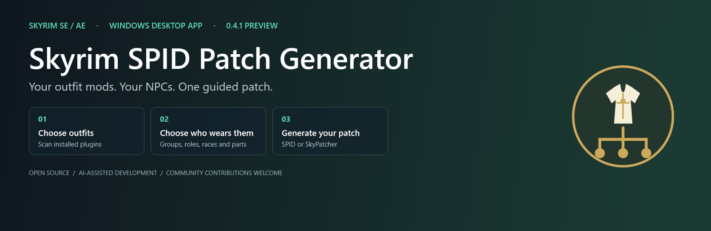
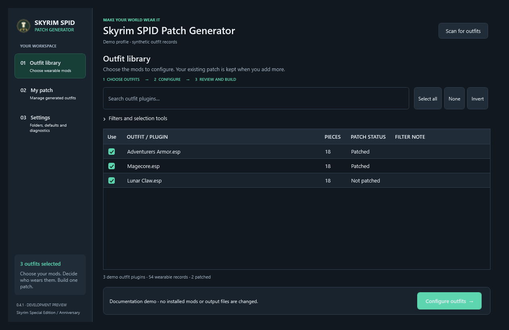
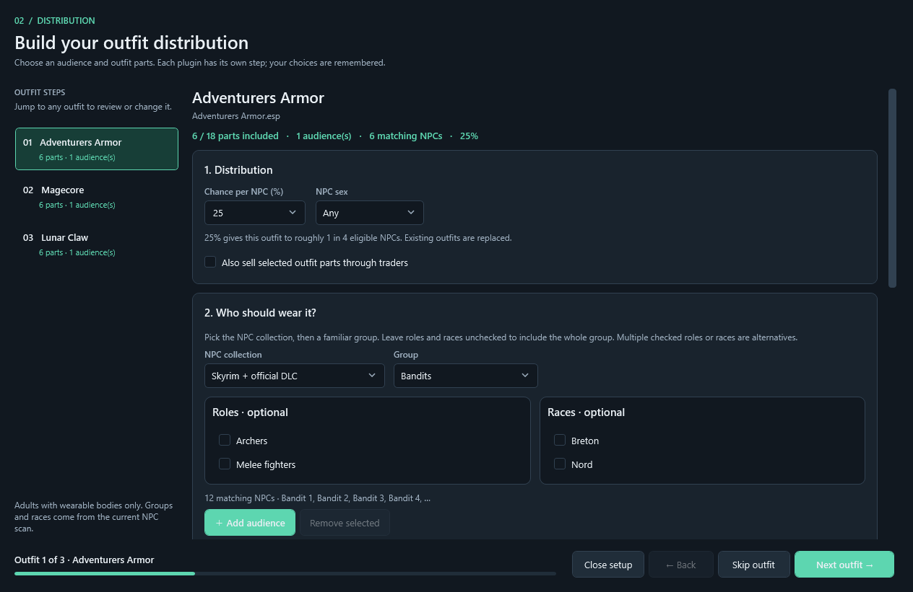
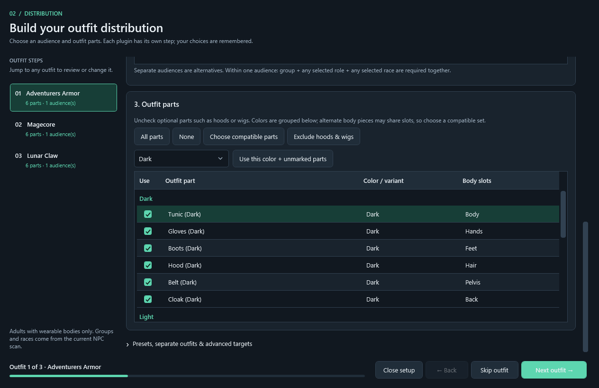
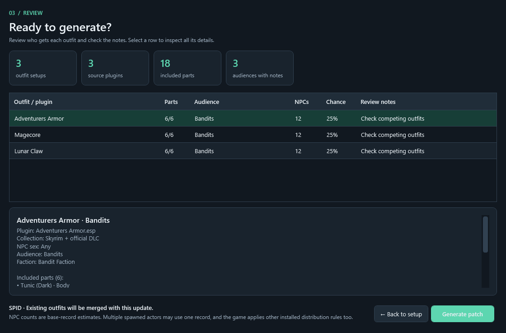
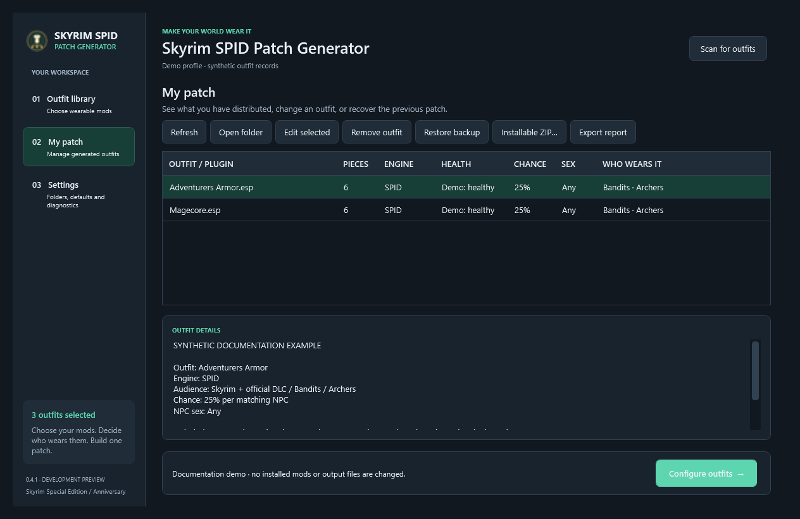
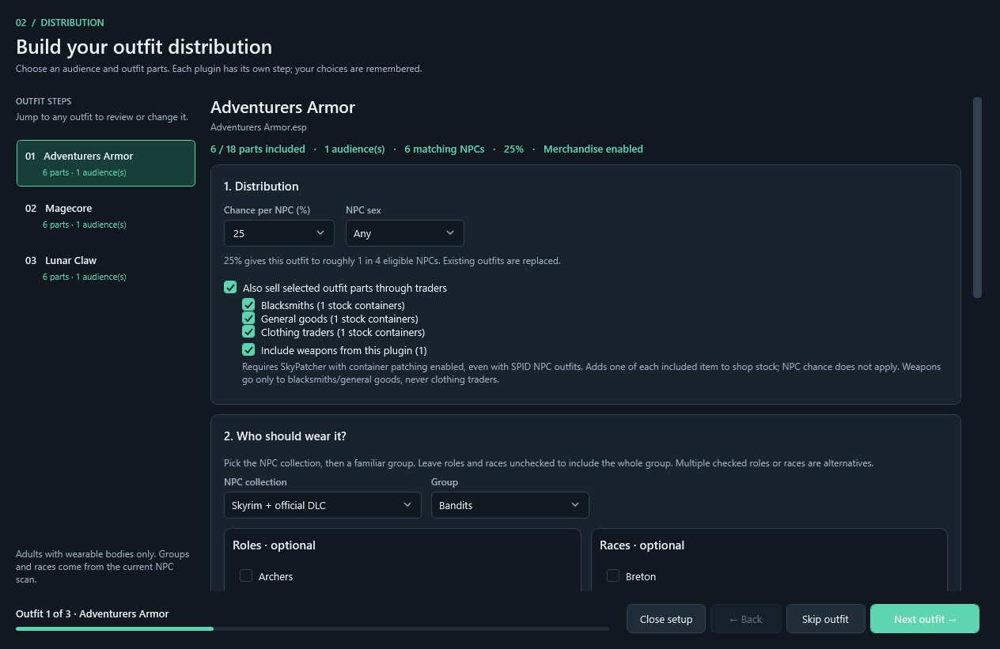
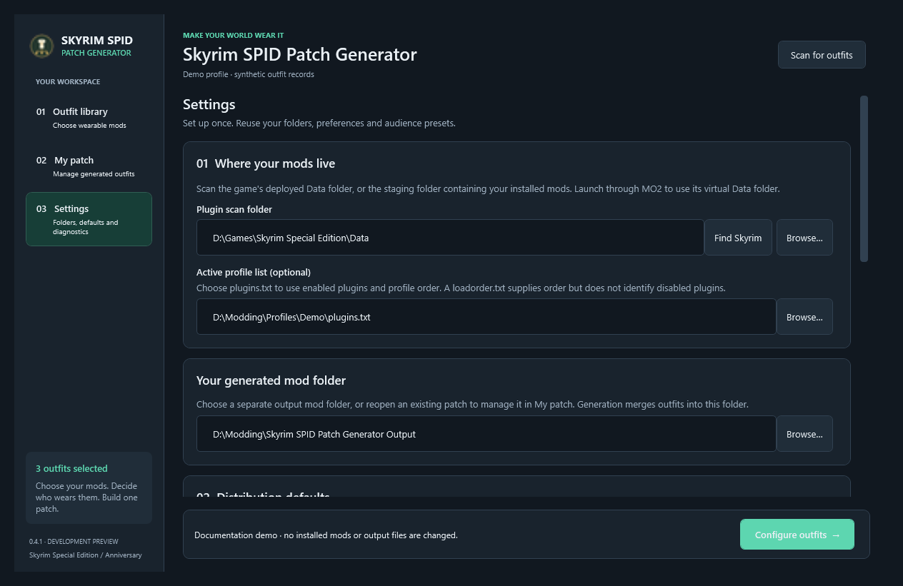

<p align="center">
  
</p>

# Skyrim SPID Patch Generator

**Give your installed outfit mods a place in Skyrim.**

Skyrim SPID Patch Generator is a Windows desktop app for Skyrim Special Edition / Anniversary Edition. It scans installed plugins for wearable armor, clothing and accessories, groups them by source plugin, and guides you through choosing **who wears what**. It generates an outfit ESP and the matching **SPID or SkyPatcher INI** without making you write distribution rules yourself.

**0.4.1 development preview** · Windows x64 · .NET 10 Desktop Runtime · MIT license

Previously called **Wearable Distributor**. Start `SkyrimSPIDPatchGenerator.exe`. Existing settings, backups and generated `WearableDistributor.*` patch filenames are retained for compatibility; they do not need renaming.

[Downloads](https://github.com/waitWTF/Skyrim-SPID-Patch-generator/releases) · [Issues and ideas](https://github.com/waitWTF/Skyrim-SPID-Patch-generator/issues) · [Changelog](RELEASE_NOTES.md) · [Source code](https://github.com/waitWTF/Skyrim-SPID-Patch-generator)

> **Preview status:** generated files have validation checks, but successful outfit distribution has not yet been confirmed in a live Skyrim session. Use a separate test profile before relying on the output in a main playthrough. Images below use synthetic demo records; they are not in-game results or a list of bundled outfit mods.

## The workflow

**Scan → Choose outfits → Configure → Review → Generate → Install**

1. **Choose outfit plugins.** Scan your installed mods, search the list, and tick the outfits you want to distribute.
2. **Choose who wears them.** Pick an NPC collection, a group such as Bandits or Farmers, and optional roles or races. Add that audience to the outfit.
3. **Choose parts and chance.** Leave out hoods, wigs or other pieces, select a suitable color/set, and set the chance supported by your engine.
4. **Skip mistakes.** Press **Skip outfit** to leave an accidentally selected outfit out of this patch session.
5. **Review and generate.** Check recipient estimates and warnings, then build into a separate output mod folder.
6. **Install.** Export an installable ZIP from **My patch**, install it in Vortex/MO2, and enable the mod and its ESP.

Generation is manual. The app does not watch folders continuously or change your load order automatically.

## A closer look

### Outfit library

Outfits are grouped by source plugin. Search, select all/none, invert selection, reveal filtered candidates, or remember exclusions.



### Guided distribution setup

An installer-style sidebar keeps your outfit steps within reach. Choose a collection and group, then narrow the audience with optional role and race selections. Live counts help identify audiences that are too broad or match nobody.



**Selected the wrong outfit?** Press **Skip outfit** beside Back/Next. Its saved choices and any previously generated version are kept. Select it in the sidebar and press **Include outfit** to undo. Skips remain in effect when returning from review, but reset for a new patch session. Skipping every outfit closes setup without generating anything.

The page scrolls while navigation stays visible. Further down, choose pieces, color variants, audience presets or separately named outfits for the same plugin. **Choose compatible parts** uses slots and color names to help select a set; it cannot inspect how meshes fit together.

<details>
<summary>See outfit parts and color controls</summary>



</details>

### Review before writing

Inspect audiences, included parts, chance and possible overlaps. **Back to setup** lets you make changes before generating.



### My patch

See which outfits have already been patched, their engine, chance, audience and file-health status. Inspect details, edit/remove outfits, restore a backup, or export an installable mod ZIP.



## Main features

| Feature | What it does |
| --- | --- |
| Wearable discovery | Reads `.esp`, `.esm` and `.esl` with Mutagen and groups new wearable records by source plugin. |
| Smart filtering | Holds back likely official content, replacers, bodies/hair/tattoos, followers, quests, frameworks and already distributed candidates. Reveal and manually include missed outfits. |
| Installed NPC audiences | Uses effective factions, classes, keywords, races and resolvable templates, including NPC records added by mods. |
| Readable targeting | Collection → group → optional roles/races. Choices come from that group's scanned population. |
| Saved setups | Remembers parts, audiences, sex and chance; supports reusable audience presets and named outfit variants. |
| Incremental patching | Add another source plugin while retaining previous plugins' outfits. Repatching preserves stable generated outfit IDs. |
| Progress and diagnostics | Background scans, cancellation, progress indicators, missing-master checks and exportable scan reports. |
| Recovery and packaging | Output validation, checksummed backups, patch-health information and generated mod ZIP export. |

Smart filtering is a convenience, not a perfect classifier. Reveal filtered candidates if an outfit is missing. Manual inclusion cannot bypass missing/inactive master requirements.

## Optional trader merchandise

Tick **Also sell selected outfit parts through traders** in each outfit's Distribution section. Then tick the trader types you want:

- **Blacksmiths**
- **General goods**
- **Clothing traders**

Selected outfit pieces are added as merchandise. If the outfit plugin also contains playable weapons, **Include weapons from this plugin** makes them available through blacksmith/general goods stock. **Only weapons are excluded from clothing traders**: the clothing and armor pieces still go to clothing traders when selected. A shared stock container also used by a clothing trader is kept free of these weapon additions.

Merchant stock targets are derived from encountered NPCs' vendor factions and linked container records in the scan. Unknown trader types and containers also used by non-vendor placements are held back. This does not automatically make every mod-added trader supported.

**Merchandise requires SkyPatcher, including when NPC outfit distribution uses SPID.** Enable its container patching option (`iEnableContainerPatching=1` in your installed `SkyPatcher.ini`). The app writes a separate container file at `SKSE/Plugins/SkyPatcher/container/WearableDistributor/WearableDistributor_Merchandise.ini`. Keep it installed with the patch. The selected NPC chance does not affect shop stock; new stock entries add one copy of each item if it is not already stocked. Existing saves may need a normal merchant restock.

This checkbox adds merchandise alongside the outfit's NPC distribution. Choices are remembered, included in merge/removal/backup handling, and packaged by **Installable ZIP**. Shop visibility, vendor buy/sell rules and other mods can still affect results; live-game verification remains outstanding.



## Requirements

| Purpose | Requirement |
| --- | --- |
| Run the app | Windows x64 and [Microsoft .NET 10 Desktop Runtime x64](https://dotnet.microsoft.com/download/dotnet/10.0). Choose **Desktop Runtime**, not only the base runtime. |
| Scan | Installed Skyrim SE/AE plugins exposed through deployed `Data`, MO2 virtual `Data`, or a mod staging folder. |
| Use the patch | Source outfit mods, required NPC/target plugins, and the selected engine with its own listed dependencies. |
| SPID output | [Spell Perk Item Distributor](https://github.com/powerof3/Spell-Perk-Item-Distributor) and its requirements for your Skyrim/SKSE runtime. |
| SkyPatcher output | [SkyPatcher](https://github.com/Zzyxz/SkyPatcher) and its requirements for your Skyrim runtime. |
| Build source | Windows, .NET 10 SDK and NuGet access for dependency restoration. |

Skyrim does not need to be running while you use the app. Legendary Edition and VR support are not established by this preview.

## Download and first setup

1. Download the Windows app ZIP from [Releases](https://github.com/waitWTF/Skyrim-SPID-Patch-generator/releases) when an asset is available. Source-and-app bundles contain the EXE in `app/`. If no compiled asset has been uploaded, build from source below.
2. **Extract the entire ZIP** into a normal folder. Keep the EXE, DLLs and JSON files together. Do not run inside the archive or copy only the EXE.
3. Start `SkyrimSPIDPatchGenerator.exe`.
4. In **Settings**, choose the scan folder, distribution engine, default chance and a separate output mod folder.
5. Supply your active profile's `plugins.txt` when available. It identifies enabled plugins and order. `loadorder.txt` supplies order but cannot identify disabled plugins.
6. Scan and follow the workflow above.

<details>
<summary>See Settings with example folder paths</summary>



</details>

### Mod Organizer 2

Add the EXE to MO2's executable list; set **Start in** to its containing folder. Launch through MO2 to expose virtual `Data`. Choose that folder and the active profile's plugin list in Settings.

Export **My patch → Installable ZIP**, install through MO2's archive installer, and enable the new mod and `WearableDistributor.esp`.

### Vortex

Deploy first. Scan deployed Skyrim `Data` for the closest view of what the game sees. A staging folder also works, but duplicate plugin copies may be ambiguous. You can add the app as an executable tool in Vortex.

Export **My patch → Installable ZIP**, drop it onto Vortex's Mods page or use **Install From File**, enable it, and deploy. Enable `WearableDistributor.esp` in **Plugins**. A generated folder on disk is not automatically registered as a managed Vortex mod.

The app does not directly manage either manager's profiles, deployment or plugin activation.

## SPID or SkyPatcher?

| | SPID | SkyPatcher |
| --- | --- | --- |
| Chance | Configurable 1–100% per named outfit | 100% assignment in this app |
| Rule file | `WearableDistributor_DISTR.ini` | `SKSE/Plugins/SkyPatcher/npc/WearableDistributor/WearableDistributor.ini` |
| Shared output | `WearableDistributor.esp` and `WearableDistributor.patch.json` | Same |
| Behavior | Overlapping audiences for one outfit are combined before writing its chance rule. Different outfits can still compete. | Default outfit assignment for matching NPCs; does not give exclusive control over other mods. |

**Bandits + Archers + 25%** means a per-NPC chance for the resolved bandit archer audience, not exactly one quarter of every encounter. Multiple selected roles/races are alternatives within their category; different categories narrow the audience together.

**100% does not replace an outfit mod everywhere.** It applies to the configured audience. Outfit distribution replaces the affected NPC's outfit, so include a suitable complete set if you want them fully dressed.

## Add more outfits later

Use the **same output folder**. Later generations merge new source plugins into the existing ESP, rules and inventory. You do not need to select every previous plugin again.

Repatching a source plugin replaces its configured variants and removes obsolete variants for that plugin. Explicitly skipped outfits are preserved, including an existing variant when another variant of that plugin is updated. To delete an existing outfit, use **My patch → Remove outfit**.

Keep the ESP, selected engine's INI and manifest together. The installable ZIP includes generated files and instructions; it does **not** bundle third-party meshes, textures or source plugins.

**Use one engine per output folder. Enable only one Skyrim SPID Patch Generator output mod at a time:** all output folders use `WearableDistributor.esp`.

## Limits and troubleshooting

- **No outfits found:** check that the folder exposes installed plugins. Launch through MO2 when applicable, check the profile list, reveal filtered candidates, and read **Settings → Scan diagnostics**.
- **An audience is missing:** only usable scanned targets are offered. Missing masters, unreadable plugins, unresolved templates or insufficient encounter evidence can exclude candidates. Farmers use occupation/faction/package evidence, not an NPC name containing “farm.”
- **Counts differ in game:** counts describe candidate NPC base records, not spawned actors. SPID can also match template/original bases. Static records cannot fully establish quest activation, script-only spawning or runtime changes.
- **Changed NPC mods/profile?** Rescan and repatch. Recipient lists are a scan snapshot, not a live monitor.
- **Outfits look wrong:** check source mods, BodySlide/body/skeleton requirements and selected pieces. There is no 3D mesh preview; slot/color assistance cannot prove visual compatibility.
- **Other outfits take priority:** other distributors and game behavior can compete. Template-inherited inventory, especially with SkyPatcher, still needs in-game verification.
- **Output is damaged:** inspect patch-health details and backup recovery. Old backups without checksum metadata cannot be restored automatically by this preview.

Settings/logs are under `%LOCALAPPDATA%\WearableDistributor`; generated-output backups use its `Backups` folder. Reports may contain paths/mod names: review before sharing.

## For modders and contributors

Corrections, improvements, forks and alternative implementations are welcome. [Open an issue](https://github.com/waitWTF/Skyrim-SPID-Patch-generator/issues) with ideas or problems. Include app version, game runtime, manager, scan-folder type, profile-list use and a redacted error/report. Do not attach another author's plugin/assets without permission.

Useful contribution areas: NPC/template resolution, wearable classification, runtime verification, accessibility, manager integration and UI usability.

### Build

```powershell
dotnet restore src/WearableDistributor.csproj
dotnet build src/WearableDistributor.csproj -c Release
dotnet run --project src/WearableDistributor.csproj
```

**`src/` is the authoritative WPF application.** Older prototype folders are not the current build target. Published apps are framework-dependent, not self-contained single-file EXEs.

| Location | Contents |
| --- | --- |
| `src/` | UI, scanner, targeting, rule compiler, patch generation, inventory, recovery and settings services |
| `tests/` | Synthetic integration checks for generation, merging, targeting, backups and packaging |
| `tools/UiPreview/` | Isolated UI preview/documentation renderer and layout checks |
| `tools/Publish-Release.ps1` | Windows/source ZIP packaging and SHA256 checksums |
| `docs/` | Architecture, verification guidance, review notes and images |

See [architecture](docs/ARCHITECTURE.md), [verification guidance](docs/TESTING.md), [development review](docs/REVIEW-0.4.1.md) and [project context](PROJECT.md). Automated checks and static scans do not establish in-game behavior; live-game testing remains outstanding.

## AI assistance, credits and license

**This project was developed with substantial AI assistance**, including architecture, implementation, UI iteration, documentation and verification tooling. Human review, testing and contributions remain essential. Please judge and improve the code on its actual behavior.

Thanks to the authors/contributors of [Mutagen](https://github.com/Mutagen-Modding/Mutagen), [SPID](https://github.com/powerof3/Spell-Perk-Item-Distributor), [SkyPatcher](https://github.com/Zzyxz/SkyPatcher), MO2, Vortex and the Skyrim modding community. MO2/Vortex installer workflows inspired the interface. This independent project is not affiliated with those tools or Bethesda.

Licensed under [MIT](LICENSE). Dependency licenses remain applicable. Outfit mods/assets belong to their authors and are not redistributed by this tool.
