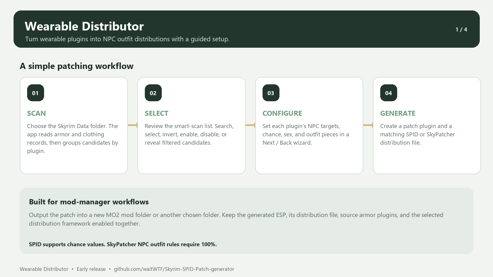
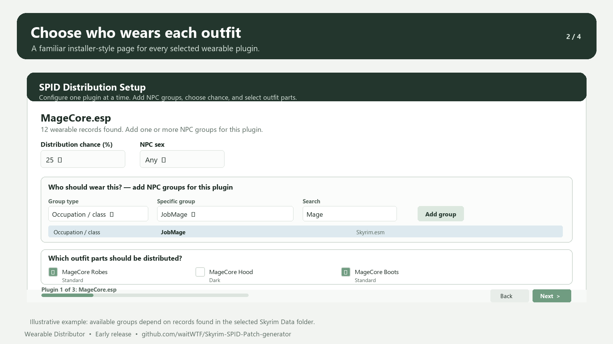
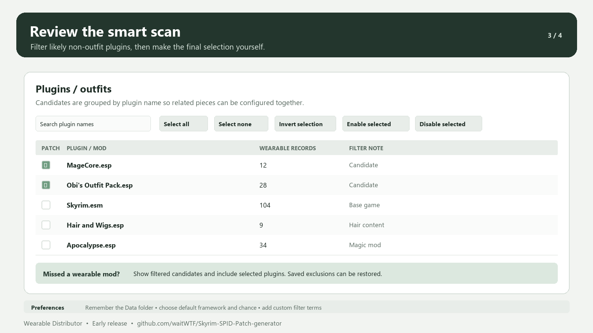
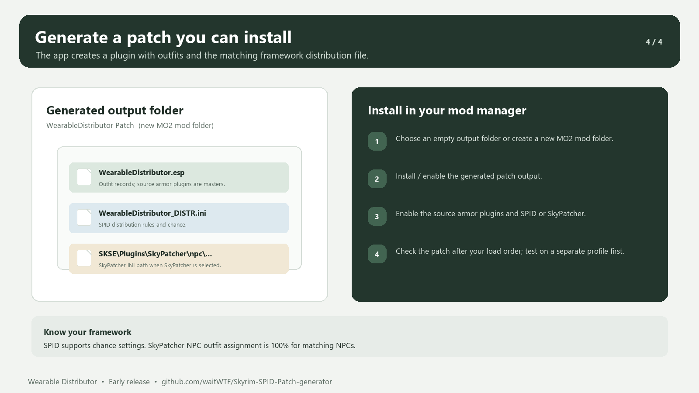

# Wearable Distributor

**Preview release: 0.1.0 · Windows x64 · 16 October 2026**

Wearable Distributor is a Windows desktop tool for Skyrim Special Edition. It scans installed Skyrim plugin files for wearable armor records, groups them by plugin, and guides you through selecting outfit pieces and the NPC groups that should receive them. It generates a patch ESP and a matching SPID or SkyPatcher configuration.

> This is an early preview. The generated plugin and distribution file are checked for basic structure by reading them back with Mutagen. The output has not yet been verified in a live Skyrim game across different load orders. Test it in a separate mod-manager profile and report issues before relying on it in a main save.

## Screenshots

### Workflow


### Outfit setup


### Smart scan


### Generated files


## Planned features/ideas
ability to have multiple outfits distributed to one single distribution like female bandit archer or farmer, necromancer etc and create a patch for that

## How NPC targeting is represented

## Features in this preview

- Scans `.esp`, `.esm`, and `.esl` files under a selected Skyrim `Data` folder using Mutagen.
- Finds armor records with wearable slots and groups them by source plugin.
- Uses plugin-name and record-name heuristics to hold back common false positives such as base game and DLC plugins, Creation Club, replacers, hair, tattoos, body mods, magic, follower, quest, and framework plugins.
- Lets you reveal filtered candidates, include candidates manually, save exclusions, or restore saved exclusions.
- Includes search, select all, select none, invert selection, enable selected, and disable selected controls.
- Provides a per-plugin, installer-style wizard with back and next navigation, progress indication, NPC targets, chance, sex, and piece inclusion controls.
- Reads Skyrim and mod-added keywords, factions, classes, and races into the NPC group selectors. A record only matches NPCs that actually use that record.
- Creates a `WearableDistributor.esp` with one outfit record per configured source plugin.
- Creates a SPID `_DISTR.ini` or the SkyPatcher NPC INI in its expected subfolder.
- Reads the generated ESP back with Mutagen and checks expected outfit records and master references; checks the distribution row count.
- Remembers the selected Data folder and user preferences locally.

The smart scan is heuristic. Review the candidates and piece checkboxes before generating a patch. The app scans the folder you select; it does not currently read the active MO2 or Vortex profile load order or resolve their virtual file systems automatically.

## Download and run

The `app` folder in this repository package contains the Windows x64 application and its companion files. Keep all files in that folder together.

1. Install the **.NET 10 Desktop Runtime (x64)** if it is not already installed.
2. Download this repository package or the `WearableDistributor-win-x64.zip` release asset.
3. Extract the files. Do not run the EXE from inside the ZIP.
4. Start `app/WearableDistributor.exe`.
5. In **Preferences**, choose the Skyrim Special Edition `Data` folder that contains the plugins you want to scan. The app may find a common Steam or GOG install automatically.
6. Select the wearable plugins to configure, press **Generate Patch**, choose the distribution options for each plugin, and select an output folder.

### Mod Organizer 2

You can add `WearableDistributor.exe` as an MO2 executable/tool. Set its **Start in** folder to the `app` folder if needed. Select a Data folder that exposes the plugins you want the scanner to see. MO2's virtual file system and active profile load order are not automatically discovered by this preview.

To install the generated patch, use a new MO2 mod folder as the output location where possible, then enable the generated patch, the source armor plugins, and SPID or SkyPatcher. If you generate into Skyrim's actual `Data` folder, use your mod manager to enable the generated ESP.

## Patch output details

The output folder contains:

- `WearableDistributor.esp` — generated outfit records. It declares the source armor plugins as masters, so those source plugins must remain installed and enabled.
- `WearableDistributor_DISTR.ini` — generated when SPID is selected.
- `SKSE/Plugins/SkyPatcher/npc/WearableDistributor/WearableDistributor.ini` — generated when SkyPatcher is selected.

SPID supports the configured chance percentage. SkyPatcher's NPC outfit rules do not support the same per-NPC random chance option, so the app requires **100%** when SkyPatcher is selected. The patch assigns the default outfit to every NPC matching its filters.

## Build from source

Requirements: Windows, the .NET 10 SDK, and access to NuGet for restoring the Mutagen dependency.

```powershell
dotnet restore src/WearableDistributor.csproj
dotnet build src/WearableDistributor.csproj -c Release
dotnet run --project src/WearableDistributor.csproj
```

The `src` folder contains the WPF app source. `Mutagen.Bethesda.Skyrim` is referenced from NuGet. The `app` folder is a framework-dependent published build, not a self-contained single-file executable. It requires the .NET 10 Desktop Runtime x64.

## Repository and contributions

Source repository: [github.com/waitWTF/Skyrim-SPID-Patch-generator](https://github.com/waitWTF/Skyrim-SPID-Patch-generator)

Contributions and issue reports are welcome. Particularly useful help includes checking output in game, load-order and MO2/Vortex integration, improving wearable classification and exclusions, and testing against varied mod lists. When reporting a problem, include the app version, Skyrim runtime, mod manager, selected scan folder type, relevant plugin names, and a redacted error message. Do not upload other mod authors' assets or plugin files without permission.

## AI assistance

AI tools assisted with architecture, implementation, interface iteration, documentation, and release preparation. The project owner remains responsible for reviewing and maintaining the project. Human testing, corrections, and contributions are welcome.

## License

No license file is included in this preview package because the project owner has not selected a license yet. Add a license before inviting reuse or redistribution under specific terms.

## Credits

Thanks to the Skyrim modding community and the authors of Mutagen, SPID, and SkyPatcher, whose tools and formats make this kind of workflow possible. This project is an independent community tool and is not affiliated with those projects or Bethesda.
